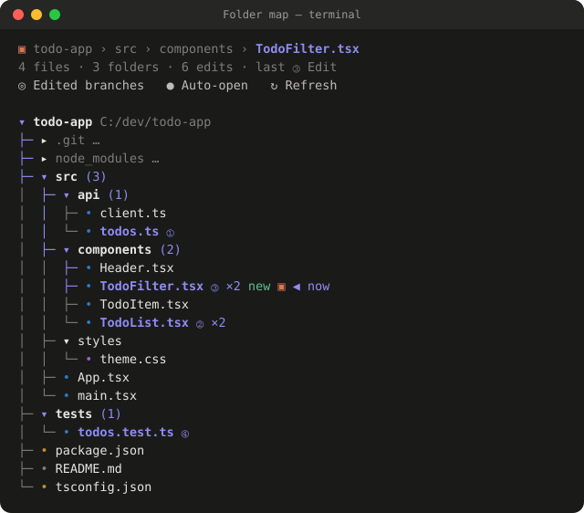

<div align="center">

# 🗺️ folder-map

**See where Claude is working, as it works.**

A Claude Code mod that opens a live map of your project whenever Claude edits a file:<br>
the folder tree, every edited file numbered in order, and a trail to the file being edited right now.

[](https://claude.com/claude-code)
[](https://github.com/topics/claude-code-mod)
[](LICENSE)



</div>

---

## ✨ Features

| | |
| --- | --- |
| 🌳 **Live folder tree** | The project tree, rescanned on each edit so new files and folders show up right away. |
| 🔢 **Numbered edits** | Each edited file gets a number (①②③…) in the order Claude first edited it, `×N` for repeat edits, and a **NEW** tag for files Claude created. |
| 📍 **Trail to now** | A highlighted path runs from the project root to the file being edited, with a breadcrumb at the top. |
| 🎯 **Edited branches mode** | Hides untouched folders so you only see the folders that hold edits. |
| 🔕 **Stays out of the way** | If you close the pane, it stays closed for edits in that folder and opens again when Claude moves somewhere else. |
| 🖥️ **Terminal and desktop** | Box-drawn text rows in the terminal, a drawn tree in the desktop app's Code tab. |

## 📸 In the terminal

<div align="center">

</div>

<sub>Both images are rendered from the mod's own drawing code for a sample project in which Claude edits four files. The desktop image above follows your light or dark theme.</sub>

## 📦 Install

Requires **Claude Code 2.1.287 or later**.

**In a Claude Code terminal session**

```text
/plugin install folder-map --marketplace letusnotc/folder-map
```

Answer `y` to add the marketplace, then pick a scope. The user scope loads it in every session.

**From a shell**

```bash
claude plugin install folder-map --marketplace letusnotc/folder-map
```

**In the desktop app** (where `/plugin` does not run): click **+** next to the prompt box, choose **Plugins**, then **Add marketplace** with `letusnotc/folder-map`, then **Add plugin**.

## 🚀 Use

Ask Claude to edit something and the map opens on its own.

| Control | What it does |
| --- | --- |
| `/folder-map` | Show or hide the pane |
| **◎ Edited branches / ▤ Full tree** | Show only the folders that hold edits, or the whole tree |
| **● Auto-open** | Turn opening on edits on or off |
| **↻ Refresh** | Rescan the folders |

Heavy folders (`node_modules`, `.git`, `dist`, `build`, `.venv`, and others) are listed but never opened. Big trees are capped so the pane stays fast.

## 🔒 Access

What the mod uses, as reported by `claude plugin validate`:

| | |
| --- | --- |
| 📂 **Reads** | Folder listings and file-exists checks (`$.fs.list`, `$.fs.exists`) in the project being edited |
| 🪝 **Hooks** | `Edit`, `Write`, `MultiEdit` and `NotebookEdit` tool calls. It records the path after the edit runs and **never blocks or changes a tool call**. |
| 🪟 **UI** | One side pane and the `/folder-map` command |
| 🚫 **Never** | Writes files, runs processes or uses the network |

## 🛠️ Development

```bash
git clone https://github.com/letusnotc/folder-map
claude --plugin-dir ./folder-map
```

```bash
claude plugin validate ./folder-map
claude plugin test ./folder-map
```

## 📄 License

[MIT](LICENSE) © 2026 Arnav Pandey
